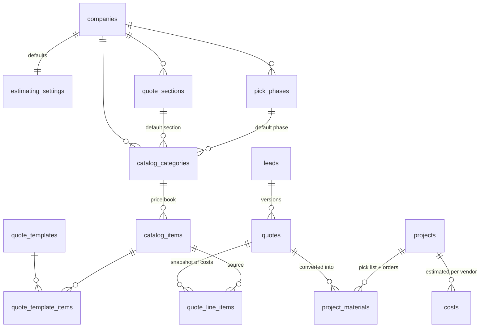

# Estimating module — spec addendum to CONTEXT.md

Quotes are built from a **price book** (catalog items with costs), started from a **template** (e.g. "10x10 L-shape - shaker + quartz"), sized by a **takeoff** (site measurements → quantities), priced by **target margin**, and frozen at approval. Approval feeds the project: estimated **costs** per vendor and a **materials list** the crew packs from.

Source material: _Kitchen Remodel Sales & Estimating Playbook_ and `Kitchen-Remodel-Estimate-10x10.xlsx`. The phone ballpark (`ballpark.ts`) reuses the same pricing. The SQL and TypeScript reproduce the workbook to the cent: $15,680.50 cost; $24,123.86 price vs the sheet's $24,123.85, 1¢ from rounding each line.

---

## 1. Where it sits in the lifecycle

| Sales stage (CONTEXT §3A) | Estimating action                                                                                                |
| ------------------------- | ---------------------------------------------------------------------------------------------------------------- |
| 4 Initial Meeting Done    | Designer creates quote v1 from a template, enters the takeoff                                                    |
| 5 Design / Quote Sent     | Quote `sent`; client sees section totals only                                                                    |
| 6 Design Approved         | `approve_quote()` freezes lines + snapshots price and cost                                                       |
| 7 Won — Deposit Received  | Project created → `materialize_quote_into_project()` writes `costs` + `project_materials`, sets `contract_value` |

Changes after approval = `duplicate_quote()` → v2 draft → approve v2 (v1 becomes `superseded`). On a live project, price changes go through `change_orders` (CONTEXT §4), not a re-quote.

## 2. Data model

| Table                       | Purpose                                                                                                                                       | Who edits                                                     |
| --------------------------- | --------------------------------------------------------------------------------------------------------------------------------------------- | ------------------------------------------------------------- |
| `estimating_settings`       | Target margin, contingency, tax, labor rate, trim waste, stick length, countertop overage, hardware spares, LED headroom, cost-staleness days | Owners                                                        |
| `quote_sections`            | Client-facing groups (1. Cabinetry … 6. Permits). One section `absorbs_project_costs` (shows contingency + tax)                               | Owners                                                        |
| `pick_phases`               | Crew phases (1. Protect & demo … 8. Finish & punch)                                                                                           | Owners                                                        |
| `catalog_categories`        | Default section, pick phase and cost category for a group of items                                                                            | Owners                                                        |
| `catalog_items`             | The price book. `cost_updated_at` auto-stamps when cost changes                                                                               | Owners, team                                                  |
| `quote_templates` (+ items) | Starter quotes with default qty and default takeoff                                                                                           | Owners, team                                                  |
| `quotes` (extended)         | Status, rates copied from settings at creation, `takeoff` jsonb, approved snapshots                                                           | Owners, team                                                  |
| `quote_line_items`          | One row per item; **costs are copied in** so later price-book changes never move an old quote                                                 | Owners, team                                                  |
| `project_materials`         | Ordering + receiving + packing per item. **No cost columns**                                                                                  | Owners, team; crew updates packing/receiving on assigned jobs |

**Views** (all `security_invoker`, so RLS applies): `quote_line_items_priced`, `quote_totals`, `quote_section_totals`, `quote_cost_rollup`.

**Functions**: `seed_default_estimating(company)`, `create_quote_from_template(lead, template, name?)`, `duplicate_quote(quote, name?)`, `approve_quote(quote)`, `materialize_quote_into_project(quote, project)`.

## 3. Pricing rules (SQL and `lib/estimating/pricing.ts` must agree)

| Quantity                                                 | Formula                                                                         |
| -------------------------------------------------------- | ------------------------------------------------------------------------------- |
| Ext. cost                                                | `round(qty × unit cost)`; labor lines use the quote's `labor_rate_cents`        |
| Line price                                               | `round(ext cost / (1 − margin))`, margin = line override or quote target        |
| Fixed-price line (`pricing_mode = 'fixed'`, e.g. quartz) | `round(qty × unit_price)`; margin is derived from cost                          |
| Contingency cost                                         | `round(direct cost × contingency_rate)`                                         |
| Tax cost                                                 | `round(taxable cost × tax_rate)`                                                |
| Contingency / tax price                                  | priced at the quote's target margin                                             |
| Gross margin                                             | `(price − cost) / price`, rounded to 4 places                                   |
| Below target                                             | margin < target − 0.05 pt → amber banner in the builder; approval still allowed |

Money is integer cents. Rates are `numeric(5,4)`. Rounding is half away from zero on both sides. `pricing.test.ts` checks the TS output against a fixture exported from the Postgres views. Regenerate the fixture whenever the SQL changes.

## 4. Takeoff keys (`lib/estimating/takeoff.ts`)

Lines whose catalog item has a `qty_source` get their qty recalculated when the takeoff is saved. Lines without one are never overwritten.

| `qty_source`                                                            | Calculation                                                         | 10x10 default |
| ----------------------------------------------------------------------- | ------------------------------------------------------------------- | ------------- |
| `countertop_sqft`                                                       | ⌈(Σruns − corners×depth − Σopenings) × depth / 144 × (1 + overage)⌉ | 35            |
| `crown_sticks`, `light_rail_sticks`, `toe_kick_sticks`, `scribe_sticks` | ⌈LF × (1 + waste) / stick ft⌉                                       | 4 / 3 / 3 / 2 |
| `door_pulls`, `drawer_pulls`                                            | count + spares                                                      | 21 / 8        |
| `led_ft`                                                                | entered                                                             | 12            |
| `countertop_outlets`                                                    | entered (≤ 48" apart)                                               | 5             |
| `cover_plates`                                                          | outlets + extra plates                                              | 6             |

Warnings (shown, not blocking): LED driver below load × (1 + headroom), counter depth < 24", no outlets entered.

Adding a key = add it to `QTY_SOURCES` in `takeoff.ts` **and** to the CHECK on `catalog_items.qty_source` (new migration).

## 5. Screens

| Screen                                                                     | Contents                                                                                                                                                                                                                                                                                            |
| -------------------------------------------------------------------------- | --------------------------------------------------------------------------------------------------------------------------------------------------------------------------------------------------------------------------------------------------------------------------------------------------- |
| **Settings → Price book**                                                  | Table of catalog items by category; inline cost edit; badge on costs older than `cost_stale_days`; CSV import/export; deactivate (never delete used items)                                                                                                                                          |
| **Settings → Templates**                                                   | Template items + qty + default takeoff; "Save quote as template"                                                                                                                                                                                                                                    |
| **Settings → Estimating**                                                  | `estimating_settings`, sections, pick phases                                                                                                                                                                                                                                                        |
| **Lead → Quotes tab**                                                      | Version list (status chips); New from template; Duplicate                                                                                                                                                                                                                                           |
| **Quote builder** (best on laptop/tablet; phone = view, edit qty, approve) | Left: takeoff form with live quantities + warnings. Main: line grid grouped by section (qty, unit, unit cost, margin override, price, line margin), add from price book. Sticky footer: cost, price, profit, margin vs target (amber when below). Buttons: Preview client quote, Mark sent, Approve |
| **Client quote preview / PDF**                                             | Section totals + descriptions, allowances, exclusions, payment schedule (`paymentSchedule()`), license number. No costs, no line-level prices                                                                                                                                                       |
| **Project → Materials tab**                                                | Grouped by pick phase; order status per line (to order → ordered → received; backordered / damaged); "Mark all from vendor as ordered"; phone pack mode with big checkboxes                                                                                                                         |

Totals in the builder are computed client-side with `quoteTotals()` for instant feedback; the saved numbers always come from the `quote_totals` view.

## 6. Role access (enforced by RLS + triggers, tested)

The company is three people plus crew: **owners** = the two partners (sales + project manager), **team** = the office admin, **crew** = installers, plumber, electrician (logins optional; see CONTEXT §1).

|                                                                 | Owner | Team (office admin) | Crew                                                             |
| --------------------------------------------------------------- | ----- | ------------------- | ---------------------------------------------------------------- |
| See every lead, quote, cost, margin, payment                    | yes   | yes                 | —                                                                |
| Change company settings: margin, rates, sections, phases, users | yes   | read only           | —                                                                |
| Price book, templates, quotes, approve, convert                 | yes   | yes                 | —                                                                |
| Project materials                                               | edit  | edit                | read + pack/receive on **assigned** jobs only (PM or has a task) |
| Change qty/name/vendor on materials                             | yes   | yes                 | refused by trigger                                               |

Approved and superseded quotes refuse line edits and pricing changes (trigger, `check_violation`).

## 7. Assumptions about 0001 (reconcile before applying 0002)

The migrations were tested against a stub of 0001 built from CONTEXT.md §4. Check these against the real 0001:

| 0002 assumes                                                                                    | If 0001 differs                                                                                                          |
| ----------------------------------------------------------------------------------------------- | ------------------------------------------------------------------------------------------------------------------------ |
| `users(clerk_id, company_id, role)` with roles `owner/team/crew`                                | Adjust the helper functions in §1 of 0002                                                                                |
| `quotes(lead_id, version, sent_at, approved_at)`; drops `line_items_json, subtotal, tax, total` | Edit the `alter table quotes` block                                                                                      |
| `projects(company_id, project_manager_id, contract_value)` in cents                             | Rename in `materialize_quote_into_project` and `is_assigned_to_project`                                                  |
| `costs(project_id, category, vendor, estimated_amount)` in cents, no `company_id`               | Add `company_id` to the insert if 0001 has it                                                                            |
| Crew assignment = project PM or a task assignee                                                 | Add `or exists (select 1 from project_members …)` to `is_assigned_to_project` once `project_members` exists (CONTEXT §5) |
| Supabase third-party auth with Clerk: `auth.jwt() ->> 'sub'` = Clerk user id                    | Same pattern as 0001's RLS                                                                                               |

## 7b. Price lists, color groups, comparison

Vendor price lists, color groups, price provenance and the Home Depot comparison are specified in `docs/QUICK-ESTIMATE.md`.

## 8. Build order

Estimating is **Phase 3** in CONTEXT §9 (after the team engine and field-to-design). The conversion step needs Phase 4's projects screens, but the tables exist from 0001.

1. Apply 0002 + 0003; call `seed_default_estimating` in the company-onboarding action and in `supabase/seed.sql`
2. `lib/estimating` + tests (provided: pricing, takeoff, ballpark)
3. Price book + estimating settings screens
4. Quote builder + takeoff form
5. Phone ballpark screen + "Save to site visit" (FIELD-AND-OFFICE §5)
   5b. Settings → Price lists (vendor import with warnings), color groups; quick estimate flow; Home Depot comparison card; monthly price-check task (QUICK-ESTIMATE §1–6)
6. Approve → client quote link
7. _(Phase 4)_ Wire "Deposit received" to `materialize_quote_into_project`; Materials tab + crew pack mode
8. Replace the sample costs with real supplier pricing before the first real quote
